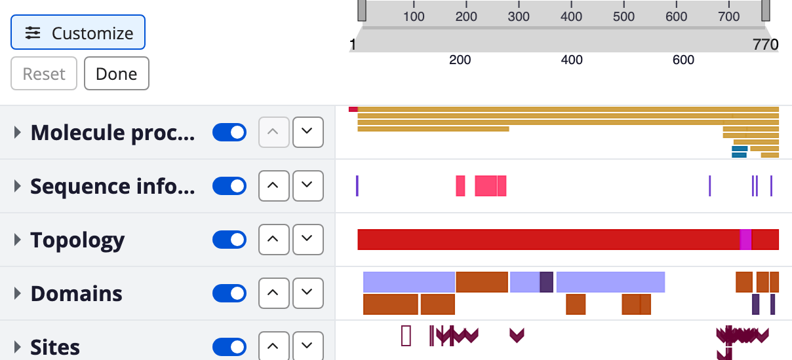

End users can reorder rows and show or hide tracks directly in the viewer,
live, without editing the config or writing code.



_The per-row controls: show or hide, and move up or down._

**The config is the source of truth.** A user's edits are written into the
viewer's configuration — reordering a row moves it in `rows:`, hiding a track
sets the same `hidden:` field an author could have written. Nothing is layered
on top at render time, so `getConfig()` exports exactly what the user
arranged, ready to be saved, shared, or handed back to `setConfig()`. That
matters most for imported data, which has no authored config to fall back on.

## Customize mode

A **Customize** button sits in the label column beside the navigation, above
the first row. Pressing it turns each row's label cell into a control cluster.
Nothing overlays or displaces the visualization — the tracks stay exactly
where they are, so you watch them reflow as you arrange them.

Each row and each track offers:

- a **show/hide switch** (`role="switch"`; its thumb position and
  `aria-checked` carry the state, so no colour or word is needed);
- **move-up / move-down** buttons to reorder it.

A group header carries the same controls, plus a collapse/expand button, and
moves or hides the whole group at once.

Reordering is by button, not by dragging. Buttons work the same for pointer,
touch and keyboard, and they are the path WCAG 2.5.7 requires in any case. The
row you moved is **briefly highlighted** afterwards, since a single press can
carry it far enough to be hard to find again.

Movement is **two-level**: rows reorder among rows, and a track reorders
within its own group. A track cannot leave its group, because a nested config
has no way to record where it went. A hidden track is left out of its group's
collapsed summary as well, and hiding every track of a group removes the group
(and its summary) from the canvas. A line-graph or coloured-sequence group's
summary draws its first visible track, so hiding or moving that track changes
what the collapsed group shows.

Rows that are hidden stay in place as dimmed **stubs** — the label and its
controls with an empty track area — so hiding is never a one-way door. Tracks
whose **data never arrived** appear the same way, but in place of the switch
they show a not-applicable sign (**⊘**, read as "no data"): showing them would
change nothing, since there is nothing to draw.

While the mode is on, the Customize button reads **Done**; pressing it leaves
the mode. Beside it, at the right of the same line, are two actions:

- **Toggle all on / Toggle all off** shows or hides every track at once. The
  label names what the press will do: any hidden track makes it "Toggle all
  on".
- **Reset to default** (enabled only once the layout differs from the
  authored config) restores the authored layout. When it disables itself,
  focus moves to Toggle all rather than being lost.

On a narrow label column the two actions wrap below Done. The line is laid
out the same way outside the mode, with the actions invisible, so opening
Customize never moves the tracks.

Below that line, the **change status** says what differs from the authored
config — "2 tracks hidden | 1 track shown | 6 tracks moved \*" — each part only
when it is non-zero. Every part counts *tracks*: hiding or moving a group of
six reads "6 tracks", and empty tracks are left out. It is measured against
the config, so a track the author ships `hidden: true` is not a change, and
showing one is. The **asterisk** (\*) also marks each row or track that sits
out of its authored order, beside its controls.

Outside customize mode the status collapses to a **Modified view** button,
shown only while the layout differs from the default. Pressing it opens
customize mode **and opens every group holding a change**, so the controls
(and asterisks) are on screen rather than folded away behind a caret, and
moves focus to Done. A hidden group lists its tracks when opened, which means
you can restore a single track of it: doing so brings the group back carrying
only that track, leaving its siblings hidden with their own switches.

The status line is always laid out, and only made invisible when there is
nothing to report, so a first change does not push the visualization down.

If everything is hidden the viewer says so and points to Customize, rather
than rendering an empty frame.

Changes apply and persist live, so there is no separate save step.

### Accessibility

Customize mode is built to WCAG 2.1 AA:

- **Keyboard**: reordering is by button, so it never depends on a dragging
  gesture (2.5.7). Focus stays on the moved row, moving to the opposite
  button when the one you pressed becomes disabled at an end.
- **Screen readers**: real `<button>` controls with accessible names ("Show
  Domains", "Move Domains up"); the show/hide control is a `role="switch"`
  reporting `aria-checked`; a polite live region announces each move ("Domains
  moved to position 2 of 12"), hide, and show (4.1.3).
- **Focus**: a visible focus ring on every control (2.4.7).
- **No colour-only state**: show/hide state is carried by the switch thumb's
  position and `aria-checked`, never colour alone (1.4.1); the off track also
  meets 3:1 non-text contrast (1.4.11) and has a forced-colors fallback.
- **Target size**: every control is at least 24×24 px (2.5.8).
- **Motion**: the just-moved highlight keeps its outline but drops its fade
  under `prefers-reduced-motion`.

## Authoring a row or track hidden (`hidden`)

A config can ship a group or track hidden by setting `hidden: true`:

```yaml
rows:
  - id: MOLECULE_PROCESSING
    tracks:
      - id: signal
        kind: features
        filter: SIGNAL
        data: features
      - id: chain
        kind: features
        filter: CHAIN
        data: features
        hidden: true # a stub in customize mode, absent from the canvas
  - id: EXPERIMENTAL_NOTES
    hidden: true # whole group hidden
    tracks:
      - id: notes
        kind: features
        data: features
```

This is not an initial-mount-only default: it is the same field the show/hide
control writes. An author's choice and a user's are the same state, and
`getConfig()` exports whichever is current.

## Runtime API

The layout can be driven programmatically, alongside `registerAdapter` /
`setTrackData`. Every change emits a `protvista-layout-change` event so an
embedder can save and restore a view.

```ts
const viewer = document.querySelector('protvista-uniprot');

// Reorder the rows by id. Unknown ids are ignored; rows the list omits keep
// their authored position, appended after.
viewer.setRowOrder(['VARIATION', 'DOMAINS', 'MOLECULE_PROCESSING']);

// Reorder the tracks within one row (row id, then track ids).
viewer.setTrackOrder('DOMAINS', ['region', 'domain']);

// Show or hide a whole lane (a group or a standalone track).
// Showing a group also clears any per-track hides inside it.
viewer.setRowVisibility('MOLECULE_PROCESSING', false);

// Show or hide one track within a group (group id, track id).
viewer.setTrackVisibility('MOLECULE_PROCESSING', 'chain', false);

// Restore the authored config (drops every reorder + show/hide).
viewer.resetLayout();

// Export the arranged view as an authored config — save it, share it, or
// hand it straight back to setConfig().
const config = viewer.getConfig();
await viewer.setConfig(config);

// Read the compact diff from the authored config (safe to keep / serialize).
const patch = viewer.getLayout();
// → { order: string[] | null, tracks: Record<string, string[]>,
//     hidden: { rows: Record<string, boolean>,
//               tracks: Record<string, Record<string, boolean>> } }

viewer.addEventListener('protvista-layout-change', (e) => {
  // e.detail is the same LayoutPatch shape as getLayout()
  console.log(e.detail.order, e.detail.tracks, e.detail.hidden);
});
```

`getConfig()` and `getLayout()` answer two different questions. `getConfig()`
returns the whole arranged configuration, in the shape it was authored — that
is the artifact to save or share. `getLayout()` returns only the **diff** from
the authored config: which rows moved (`order`), which tracks moved within
their row (`tracks`), and what was shown or hidden (`hidden`, split into
`hidden.rows` keyed by row id and `hidden.tracks` keyed by row id then track
id). The diff exists because it is small enough to put in a URL.

## Persistence and sharing

A customized layout persists automatically, as that compact patch:

- **localStorage**, keyed per config (a hash of the config's row + track
  ids), so a user's layout survives a reload in the same browser and applies
  to every protein viewed with the same config.
- **A shareable `?layout=` URL parameter**, updated as the user customizes,
  so the exact view can be sent by link.

On mount the restore precedence is **`?layout=` URL > localStorage >
authored default**, and the patch is replayed onto the authored config before
the first render. "Reset to default" clears both stores.

A saved patch tolerates the config changing underneath it: unknown ids are
ignored, and rows or tracks it does not mention keep their authored position
and visibility. Editing a config does not throw away users' arrangements.

Set the **`no-persist-layout`** attribute to opt out entirely. A viewer with
this attribute neither restores a saved/shared layout nor writes one, which
is the right choice for an embedder that manages layout itself:

```html
<protvista-uniprot accession="P05067" no-persist-layout></protvista-uniprot>
```

## Next steps

- [Author a config](/protvista/configure) — the rest of the config structure `hidden:` sits in.
- [Escape hatches](/protvista/escape-hatches) — the other runtime registration methods (`registerAdapter`, `setTrackData`) the layout API sits beside.
- [Configuration vs data](/protvista/configuration-vs-data) — why an arranged view exports as a config rather than a parallel overlay.

_Licensed under [CC BY 4.0](https://creativecommons.org/licenses/by/4.0/)._
